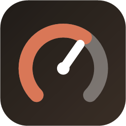

# Dash — a usage meter and task planner for Claude Code



Dash shows how much of your Claude Code **5-hour session** and **weekly** limit you have used, how fast you are burning it, and whether you will hit the limit before it resets. It can also **estimate what a task will cost** before you start it, per model and effort, and learn from what tasks actually cost.

- `claude-dash status` in the terminal, or `claude-dash open` for a local dashboard with charts
- several accounts side by side (every Claude Code config dir, e.g. `~/.claude` and `~/.claude-work`)
- a Claude Code **skill**, so Claude checks the budget itself before a big task
- no dependencies: one Node script and one HTML page; nothing leaves your machine except the call to Anthropic's usage endpoint

```
Dash · personal (max)
Session (5h): [████████░░░░░░░░░░░░░░░░░░░░░░░░░░░░░░░░] 21% used · burn 6.3%/h (recent slope) · projected 46% at reset · no limit hit before reset · resets Mon 17:59 (in 3.9h)
Weekly (7d):  [████░░░░░░░░░░░░░░░░░░░░░░░░░░░░░░░░░░░░]  9% used · burn 0.2%/h (window average) · projected 32% at reset · no limit hit before reset · resets Sat 08:59 (in 4.8d)
```

> **Unofficial.** Dash reads the same endpoint Claude Code's `/usage` command uses (`/api/oauth/usage`) with the OAuth token Claude Code already stored on your machine. It is not an Anthropic product and the endpoint may change without notice.

## Requirements

- Node.js 18 or newer
- Claude Code, logged in with a Claude subscription (Pro / Max / Team). API-key-only setups have no session or weekly limits to show.

## Install

```sh
git clone https://github.com/vince-nap/claude-dash.git
cd claude-dash
npm link          # optional: puts `claude-dash` on your PATH
claude-dash init  # writes a starter config with the accounts it finds
claude-dash status
```

Without `npm link`, run `node dash.mjs <command>` (Windows: `claude-dash.cmd <command>`).

## Commands

| Command | What it does |
|---|---|
| `claude-dash status` | Current usage, burn rate, projected % at reset, projected limit-hit time |
| `claude-dash open [--app]` | Starts a local server on `127.0.0.1` and opens the dashboard (`--app` opens it in its own Chromium window) |
| `claude-dash plan --size XS\|S\|M\|L\|XL [--agents N] [--desc "…"] [--json] [--open]` | Cost of a task per model and effort, whether it fits, and a recommendation |
| `claude-dash done [--model m --effort e]` | After a planned task: measures what it really cost and recalibrates the estimates |
| `claude-dash snapshot` | Records a data point; run it on a schedule for better burn-rate projections |
| `claude-dash accounts` | Lists the accounts Dash knows |
| `claude-dash init [--path f] [--force]` | Writes a starter config |
| `claude-dash config` | Shows which config file, data dir and accounts are in use |

All commands take `--account <key|plan>` and `--config <file>`.

## The dashboard

`claude-dash open` serves a local dashboard (light and dark, follows your OS or the toggle in the header), styled after the android menus of *Detroit: Become Human*: the session and weekly gauges are LED rings that go blue → yellow → red, always with the status in words beside them.

| Panel | Shows |
|---|---|
| Session / Weekly | Used %, status, burn rate, projected % at reset, when the limit is hit, reset time, window elapsed |
| Forecast | Both windows at reset, the projected limit hit, how far ahead or behind an even weekly pace you are, your daily budget against your current pace, and how many full sessions are left this week |
| KPI strip | Session and weekly burn, time to each reset, daily budget, 7-day average, snapshots recorded |
| Session / Weekly window | Consumed vs. projected over the window, with the limit and (weekly) an even-pace line; hover for exact values |
| Daily consumption | Weekly % used per day over 14 days, with your average and daily budget |
| Calendar | Six weeks of daily use as a heatmap |
| Session peaks | The highest % of each 5-hour window, flagged at 80% and at the limit |
| Rhythm | When in the day you use your session |
| By surface / Model limits | Weekly use per surface (Claude Code, other apps) and per-model weekly limits, when your plan has them |
| Cost model | The task-size estimates, multipliers and calibration runs behind `claude-dash plan` |
| Telemetry log | Every recorded point, with CSV export |

The day, calendar, peak and rhythm views are built from Dash's own snapshots, so they fill in as it records: every minute while the dashboard is open, plus whenever you run a command. For a complete picture, schedule `claude-dash snapshot` (Task Scheduler, cron or launchd) every 10–15 minutes.

## Configuration

Dash works without a config: it finds every `~/.claude*` directory and stores its data in your OS data folder. A config file lets you choose. It is read from the first of:

1. `--config <file>`
2. `$DASH_CONFIG`
3. `dash.config.json` next to `dash.mjs` (ignored by git)
4. the user config: `%APPDATA%\claude-dash\config.json` on Windows, `~/.config/claude-dash/config.json` elsewhere (`$XDG_CONFIG_HOME` is honoured)

```jsonc
{
  "accounts": [                          // omit to auto-discover ~/.claude*
    { "key": "personal", "dir": "~/.claude" },
    { "key": "work", "dir": "~/.claude-work" },
    { "key": "other", "dir": "~/.claude-other", "tokenCommand": "my-secret-tool get claude" }
  ],
  "defaultAccount": null,                // default: $CLAUDE_CONFIG_DIR, else ~/.claude
  "dataDir": null,                       // default: see below
  "port": 7077,
  "browser": null,                       // Chromium path for `open --app`; default: common locations
  "idleShutdownMinutes": 30,             // the dashboard server stops after this much idle time
  "costModel": {                         // starting estimates; `claude-dash done` refines them per account
    "sizes":  { "XS": 0.5, "S": 2, "M": 6, "L": 15, "XL": 35 },
    "model":  { "haiku": 0.35, "sonnet": 1, "opus": 1.7, "fable": 3 },
    "effort": { "low": 0.6, "medium": 1, "high": 1.6, "xhigh": 2.4, "max": 3.5 },
    "weeklyPerSession": 0.12
  }
}
```

See [`config.example.json`](config.example.json).

**Tokens.** Dash reads the OAuth token from `<dir>/.credentials.json`, which is where Claude Code keeps it on Windows and Linux. On macOS Claude Code uses the login Keychain; Dash tries the `Claude Code-credentials` entry for `~/.claude`. For any other setup, give the account a `tokenCommand` that prints either the token or the credentials JSON. Dash never writes or refreshes tokens: if one has expired, start a Claude Code session on that account.

**Data.** History (`history.jsonl`) and calibration (`calibration.json`) are kept per account in `dataDir`, by default `%LOCALAPPDATA%\claude-dash` (Windows), `~/Library/Application Support/claude-dash` (macOS) or `~/.local/share/claude-dash` (Linux).

## How the numbers work

- **Usage and resets** come straight from the endpoint, so they match `/usage`.
- **Burn rate** is the slope over the last two hours of snapshots when there are enough, otherwise the average since the window started. More snapshots (from `status`, `plan`, the dashboard, or a scheduled `claude-dash snapshot`) give better projections.
- **Task estimates** are `size × model × effort × agents`, in % of a 5-hour session, with a 15% overhead per extra parallel agent. They start from the seeds above. `claude-dash plan` remembers the starting point; `claude-dash done` measures the real difference and moves the size estimate 30% of the way towards it. Other activity on the same account in the meantime counts too, which is why the step is small.

## Use it from Claude Code

Copy `skill/SKILL.md` to `~/.claude/skills/dash/SKILL.md` (or the `skills` folder of your other config dirs). Claude then runs `claude-dash plan` before large tasks, shows you the options, and runs `claude-dash done` afterwards. If `claude-dash` is not on your PATH, change the CLI line in the skill to `node /path/to/claude-dash/dash.mjs`.

## Privacy

The dashboard server listens on `127.0.0.1` only. The page shows the e-mail address of each account, read from your local Claude Code config. Nothing is sent anywhere except the usage request to `api.anthropic.com`.

## License

MIT
